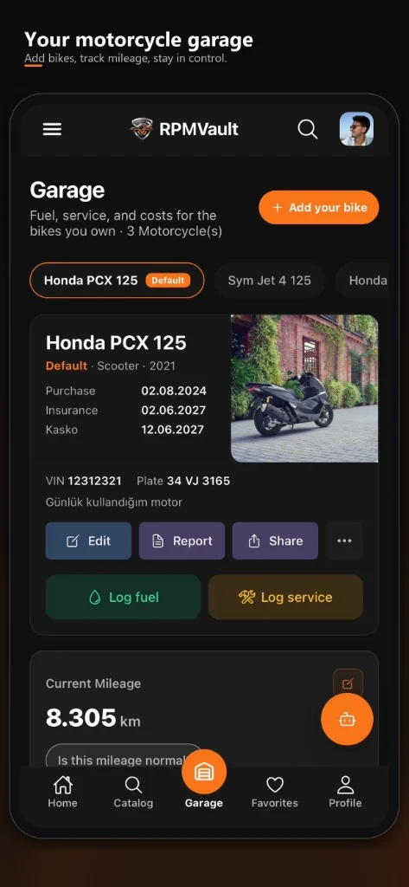
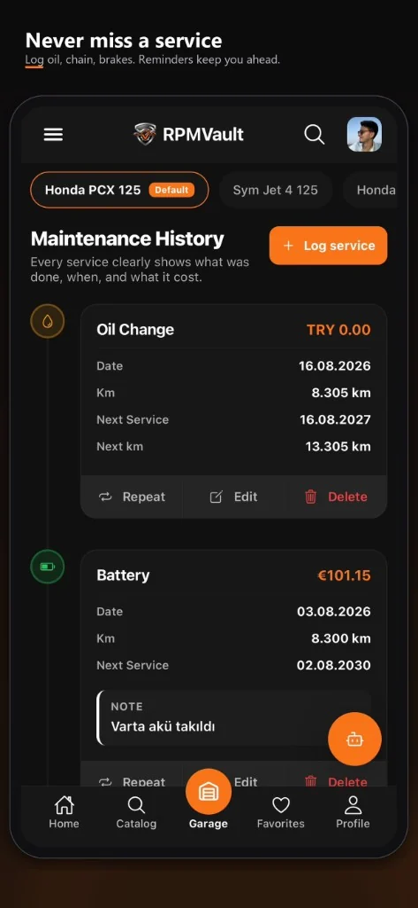
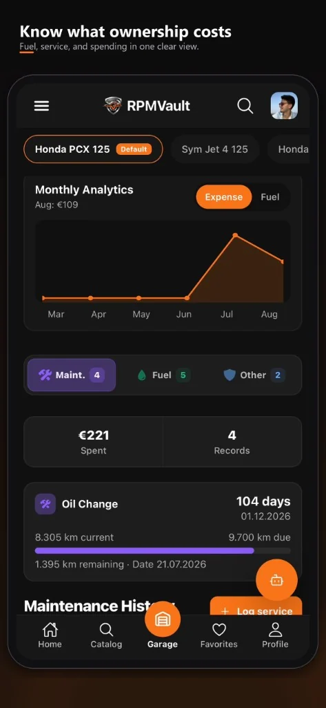
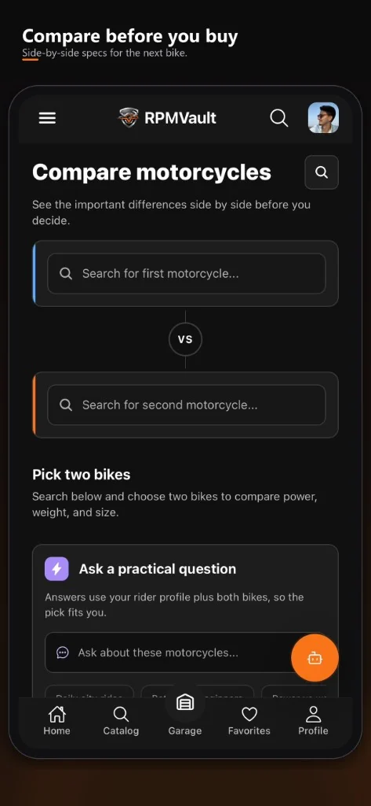
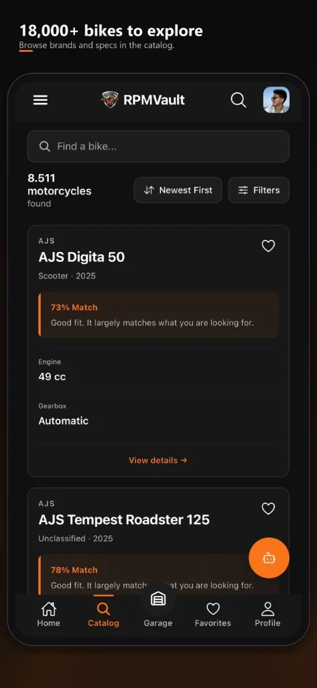
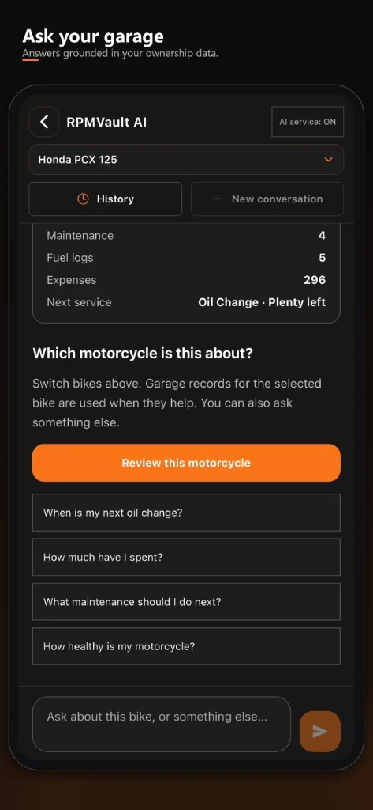

# RPMVault

> Your digital motorcycle garage. Track maintenance, fuel, mileage, and ownership costs, then explore and compare 18,000+ motorcycles on the web, iPhone, and Android.

Solo-built and in production: [web](https://rpm-vault.com), [iOS](https://apps.apple.com/tr/app/rpmvault-motorcycle-garage/id6799125794), and [Android](https://play.google.com/store/apps/details?id=com.ballioz.rpmvault). One account, English and Turkish. Source is private. This repo is the public engineering summary.

## Product

<p align="center">
  
  
  
</p>
<p align="center">
  
  
  
</p>

## Why this exists

Motorcycle ownership usually lives in notes, photos, and memory. Service dates slip. Fuel and shop bills stay vague. Research for the next bike happens in a different tab.

RPMVault is the place I wanted as a rider: log the bike I already ride, see what it costs to keep, and compare the next one in the same account. The mission is simple. Make ownership legible: what you spent, what is due, what you might buy next. AI is a helper on that record. It is not a mechanic.

## What I shipped

Web, mobile, and API. Store releases. Billing. Bilingual copy and SEO. If it ships, I own it.

Three calls that keep the product one system:

- **Shared domain.** Web and mobile use the same TypeScript types, API client, and garage math, so a service interval does not drift between platforms.
- **Store billing, account entitlement.** Premium is purchased on iOS or Android. The server verifies the store. The same account sees it on the web. There is no second checkout.
- **Garage first.** Mileage, fuel, service, and expenses hang off the bike you own. Catalogue and compare sit in the same account.

| | Web | Mobile |
| --- | :---: | :---: |
| Garage, fuel, service, expenses, PDF report | ✅ | ✅ |
| Catalogue (18,000+ bikes) and side-by-side compare | ✅ | ✅ |
| RPMVault AI on the selected bike and garage context | ✅ | ✅ |
| Device calendar for upcoming maintenance | | ✅ |
| Premium (App Store / Play, entitlement on web) | ✅ | ✅ |

Premium is optional. It raises AI and PDF quotas. AI is informational, not a mechanic.

```
Web  ─┐
      ├─ signed-in requests ─► API
iOS / Android ─┘                 │
                                 ├─ database
                                 ├─ auth
                                 └─ store billing
```

Private garage data is available only to a signed-in account. Implementation details stay with the private source.

_README and screenshots only. Source is private. All rights reserved._
